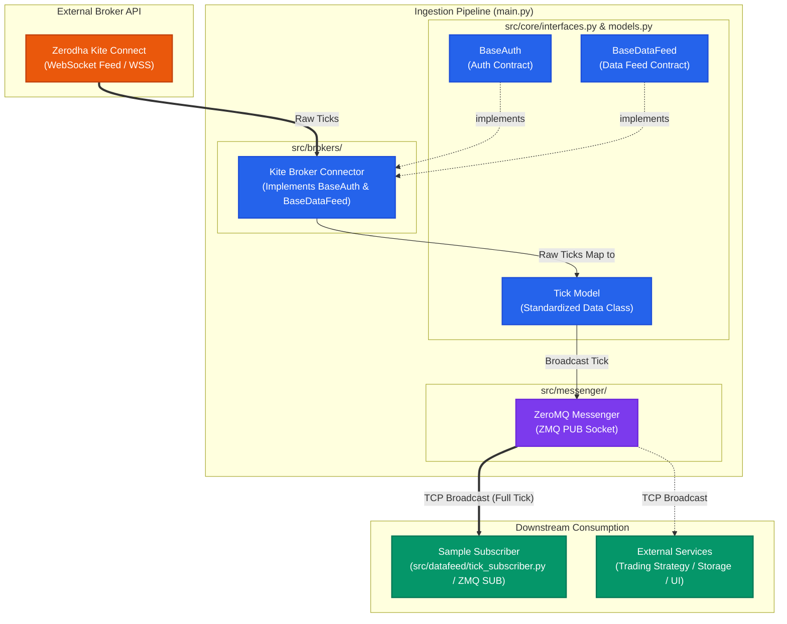

# Kite Connect Tick Feed Ingester

A modular, extensible framework for ingesting real-time market tick data, designed for systematic development.

## Project Overview

This project provides a robust data pipeline to consume live market ticks from a broker API, normalize them, and broadcast them via ZeroMQ for downstream consumption (e.g., storage, analysis, strategy execution).

### Key Features
- **Decoupled Architecture:** Clean separation between data ingestion (Broker-specific) and data consumption (Messaging). Easily swap or add new brokers by implementing the core interfaces.
- **Normalization:** Standardized Tick data model ensures downstream consumers receive consistent data regardless of the underlying broker's API format.
- **ZeroMQ Integration:** High-performance messaging layer to broadcast tick data to multiple subscribers. *Note: Currently, the messenger is tightly coupled to ZeroMQ, but if requested or needed, we are open to decoupling it into a generic publisher interface and adding support for alternative messengers (e.g., Redis, Kafka, WebSockets).*
- **Sample Subscriber:** Includes a basic subscriber implementation to demonstrate how to consume the ingested data.

## Architecture



1.  **Broker Connector (`src/brokers/`):** Establishes a WebSocket connection to the broker (e.g., Zerodha KiteConnect), receives raw ticks, and maps them to the `Tick` model.
2.  **Core Interfaces (`src/core/`):** Defines the contracts (`BaseAuth`, `BaseDataFeed`) for authentication and data ingestion.
3.  **Messenger (`src/messenger/`):** A ZeroMQ publisher that broadcasts the normalized `Tick` objects.
4.  **Subscriber:** Any external service can connect to the ZMQ socket to consume the live feed.

## Data Model

The system provides a high-performance, memory-efficient standardized `Tick` model utilizing `__slots__` and binary serialization (`struct` packer):

```python
@dataclass(slots=True)
class Tick:
    instrument_token: int
    timestamp: float
    ltp: float
    volume: int

    def to_bytes(self) -> bytes:
        return TICK_STRUCT.pack(self.instrument_token, self.timestamp, self.ltp, self.volume)

    @classmethod
    def from_bytes(cls, raw: bytes):
        token, ts, ltp, vol = TICK_STRUCT.unpack(raw)
        return cls(token, ts, ltp, vol)
```
## Getting Started

### Prerequisites

- Python 3.10+
- Broker API credentials (e.g., Zerodha API Key/Secret)

### Setup

1.  Clone the repository:
    ```bash
    git clone <repository-url>
    cd kite-connect-tick-feed-ingester
    ```

2.  Install dependencies (setup virtual environment first):
    ```bash
    python -m venv .venv
    source .venv/bin/activate
    pip install -r requirements.txt
    ```

3.  Configure your environment (create a `.env` file for credentials).

### Running the Ingester

Run the main ingestion service:
```bash
python main.py
```

### Consuming the Data

Run the sample subscriber to verify the feed:
```bash
# In a separate terminal
python src/datafeed/tick_subscriber.py
```

## Extending to New Brokers

To add a new broker:
1.  Implement `BaseAuth` from `src/core/interfaces.py` to handle authentication.
2.  Implement `BaseDataFeed` from `src/core/interfaces.py` to handle WebSocket connection and normalization.
3.  Register the new implementation in the main application flow.

## Documentation

- **Core Interfaces:** See `src/core/interfaces.py` for API contracts.
- **Models:** See `src/core/models.py` for data definitions.
